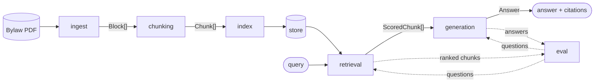

# Architecture

open-parcel answers zoning questions about Ottawa parcels, with citations back to the bylaw.
This doc describes how the pieces fit together and where future techniques plug in.

**Status:** M0 exploration is notebook-first. The `src/open_parcel/` package below is a
skeleton of interfaces; code moves into it from the notebooks as each stage stabilises.

## Approach

Build the whole pipeline end to end with the simplest thing that works, measure it, and only
then make one stage smarter at a time. Every stage talks to the next through a small, stable
interface, so a new technique (hybrid search, graph RAG, an agent) is a new implementation of
an existing interface rather than a rewrite. See
[0003](decisions/0003-vector-baseline-before-graph-rag.md).

## Pipeline



| Stage      | Package                   | In → out                         | Interface   | Baseline                      |
| ---------- | ------------------------- | -------------------------------- | ----------- | ----------------------------- |
| ingest     | `open_parcel.ingest`      | PDF → `Block[]`                  | `Ingestor`  | PyMuPDF text + `find_tables`  |
| chunking   | `open_parcel.chunking`    | `Block[]` → `Chunk[]`            | `Chunker`   | PyMuPDF `to_chunks` + rules   |
| index      | `open_parcel.index`       | `Chunk[]` → store                | `Indexer`, `Embedder` | one embedding model, in-memory |
| retrieval  | `open_parcel.retrieval`   | query → `ScoredChunk[]`          | `Retriever` | cosine top-k                  |
| generation | `open_parcel.generation`  | query + chunks → `Answer`        | `Generator` | one prompt, cite chunk ids    |
| eval       | `open_parcel.eval`        | questions → metrics              | —           | recall@5, MRR                 |

## Interfaces

All shared types live in [`src/open_parcel/schemas.py`](../src/open_parcel/schemas.py).

```python
@dataclass(frozen=True)
class Chunk:
    id: str             # stable across runs, e.g. "s.161(5)" or "table-161#row-12"
    text: str
    section_path: str   # "Part 6 > Section 161 > (5)"
    kind: ChunkKind     # provision | definition | table_row | table | figure
    page_start: int
    page_end: int
    meta: dict          # technique-specific extras (table header, defined term, ...)

@dataclass(frozen=True)
class ScoredChunk:
    chunk: Chunk
    score: float
    source: str         # "vector", "bm25", "graph", ...

class Retriever(Protocol):
    name: str
    def retrieve(self, query: str, k: int) -> list[ScoredChunk]: ...
```

`Answer` carries the generated text, its `Citation`s (chunk id, section path, pages) and the
chunks the generator saw, so eval can score retrieval and generation from the same object.

The rule that keeps this modular: **eval and generation only ever call `retrieve`.** Anything
a technique needs beyond that (a graph, a BM25 index, a tool loop) lives behind its
`Retriever` implementation and in `Chunk.meta`.

## Configs and experiments

- `configs/<name>.yaml` describes one run: which implementation each stage uses and its
  parameters. `configs/baseline.yaml` is the reference; each experiment changes one thing.
- `eval/questions.jsonl` is the labelled question set, version-controlled so runs are
  comparable. Format in [`eval/README.md`](../eval/README.md).
- `experiments/<date>_<config>/` keeps the config copy, metrics and a short note for each run.
  Kept runs get a row in the README results table.
- `docs/decisions/` records why each significant choice was made.

## Future plug-ins

Each of these is planned as a new implementation behind an existing interface, compared
against the baseline on the same question set.

| Milestone | Technique | Where it plugs in | Notes |
| --- | --- | --- | --- |
| M3 | **Hybrid search** | `HybridRetriever` | BM25 + vector, fused with reciprocal rank fusion. Bylaw text is full of exact terms ("lot line, front", zone codes) that keyword search handles well. |
| M3 | **Reranking** | wraps any `Retriever` | Cross-encoder over the top 50, returns top k. Same protocol in and out. |
| M4 | **Graph RAG** | `GraphRetriever` + a graph index | Nodes: sections, definitions, tables, zones. Edges: "refers to", "defines", "part of", "applies in zone". Retrieval expands from seed chunks along edges, e.g. pull in the definition of every defined term a provision uses. |
| M4 | **Agentic retrieval** | `AgenticRetriever` | An LLM loop that can call the other retrievers as tools, follow cross-references and stop when it has enough. Still returns `list[ScoredChunk]`, so eval is unchanged. |
| M5 | **Geo lookup** | a step before retrieval | Address → parcel (City of Ottawa open data) → zone code and exceptions → filter or boost chunks whose `meta` matches that zone. Turns "what can I build at 123 Main St?" into a zone-scoped bylaw query. |

Things that would change an interface, and how they would be handled:

- **Multi-step answers** (agentic) may want to return reasoning steps as well as chunks. Put
  them in `Answer.meta` rather than widening `Retriever`.
- **Geo context** (zone code) is extra input to retrieval. Planned as an optional
  `filters: dict` argument on `retrieve`, added when M5 starts, with a default so existing
  retrievers keep working.

## Repo layout

```
src/open_parcel/
  schemas.py        # Block, Chunk, ScoredChunk, Citation, Answer
  config.py         # load configs/*.yaml
  ingest/  chunking/  index/  retrieval/  generation/  eval/
configs/            # baseline.yaml, later hybrid.yaml, graph.yaml, ...
eval/               # questions.jsonl + format
experiments/        # one folder per run
notebooks/          # EDA; code is promoted into src/ once it stabilises
docs/               # this file and decisions/
legacy/             # earlier Toronto / Postgres work, kept for reference
tests/
```
